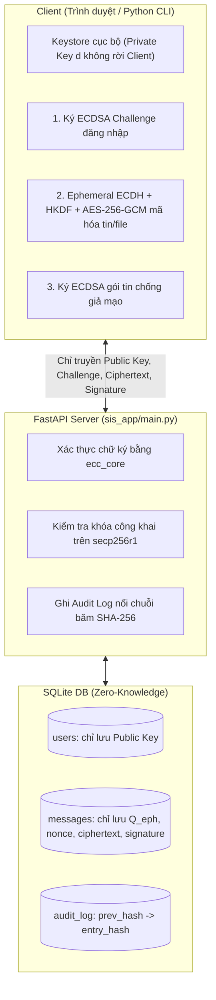

# BÁO CÁO ĐỒ ÁN CHUYÊN NGÀNH

**ĐỀ TÀI:**  
**A STUDY ON THE IMPLEMENTATION OF THE ECC ALGORITHM FOR A SECURE INFORMATION SYSTEM**  
*(Nghiên cứu cơ chế vận hành thực tế và triển khai thuật toán ECC cho Hệ thống Thông tin Bảo mật)*

---

**Trường:** `[Điền tên Trường / Khoa]`  
**Ngành:** `[An toàn thông tin / Công nghệ thông tin]`  
**Sinh viên thực hiện:** `[Họ và tên — MSSV]`  
**Giảng viên hướng dẫn:** `[Học hàm, Học vị, Họ và tên]`  
**Năm học:** `2026`

---

## ĐỊNH HƯỚNG TIẾP CẬN CỦA BÁO CÁO

Khác với các báo cáo thuần túy chứng minh toán học, báo cáo này tập trung trả lời 3 câu hỏi thực tế trong kỹ thuật xây dựng hệ thống bảo mật:
1. **ECC giải quyết bài toán gì trong thế giới thực và đang được ứng dụng ở đâu?** (HTTPS/TLS 1.3, Passkeys/FIDO2, Signal/WhatsApp E2EE, Blockchain, ePassport).
2. **Bên dưới một hệ thống bảo mật dùng ECC, dữ liệu thực sự chạy qua từng bước như thế nào?** (Từ lúc người dùng bấm đăng nhập không mật khẩu, gửi file mật, lưu vào database Zero-Knowledge, đến lúc phát hiện kẻ tấn công sửa 1 byte bản mã).
3. **Khi tự triển khai ECC vào hệ thống thực tế, lập trình viên gặp những cạm bẫy nào và hiệu năng đánh đổi ra sao?** (Tối ưu tốc độ gấp ~4.65–6x bằng Jacobian, phòng chống lỗ hổng trùng nonce $k$, phòng chống điểm giả mạo, và so sánh chi phí thực tế với RSA).

---

## MỤC LỤC

- [CHƯƠNG 1. BÀI TOÁN THỰC TẾ VÀ ỨNG DỤNG CỦA ECC TRONG CÔNG NGHIỆP](#chương-1-bài-toán-thực-tế-và-ứng-dụng-của-ecc-trong-công-nghiệp)
- [CHƯƠNG 2. CƠ CHẾ HOẠT ĐỘNG THỰC TẾ CỦA ECC (GÓC NHÌN KỸ SƯ HỆ THỐNG)](#chương-2-cơ-chế-hoạt-động-thực-tế-của-ecc-góc-nhìn-kỹ-sư-hệ-thống)
- [CHƯƠNG 3. THIẾT KẾ VÀ VẬN HÀNH HỆ THỐNG THÔNG TIN BẢO MẬT ECC-SIS](#chương-3-thiết-kế-và-vận-hành-hệ-thống-thông-tin-bảo-mật-ecc-sis)
- [CHƯƠNG 4. CẠM BẪY TRIỂN KHAI THỰC TẾ VÀ CÁCH PHÒNG CHỐNG](#chương-4-cạm-bẫy-triển-khai-thực-tế-và-cách-phòng-chống)
- [CHƯƠNG 5. THỰC NGHIỆM ĐÁNH GIÁ HIỆU NĂNG VÀ KIỂM THỬ HỆ THỐNG](#chương-5-thực-nghiệm-đánh-giá-hiệu-năng-và-kiểm-thử-hệ-thống)
- [CHƯƠNG 6. KẾT LUẬN VÀ KHẢ NĂNG ÁP DỤNG THỰC TIỄN](#chương-6-kết-luận-và-khả-năng-áp-dụng-thực-tiễn)

---

## CHƯƠNG 1. BÀI TOÁN THỰC TẾ VÀ ỨNG DỤNG CỦA ECC TRONG CÔNG NGHIỆP

### 1.1. Vấn đề thực tế của các Hệ thống Thông tin hiện nay
Trong một hệ thống thông tin doanh nghiệp (trao đổi hợp đồng, hồ sơ bệnh án, chứng từ tài chính), mô hình bảo mật truyền thống thường chỉ dừng lại ở **TLS trên đường truyền + mã hóa tại máy chủ**. Cách làm này tồn tại 3 điểm yếu lớn:
1. **Rủi ro lộ dữ liệu tại Server**: Nếu máy chủ bị chiếm quyền (SQL Injection, lộ bản backup DB, hoặc quản trị viên nội bộ truy cập trái phép), toàn bộ dữ liệu đọc được ngay vì khóa giải mã nằm trên server.
2. **Rủi ro xác thực bằng mật khẩu**: Mật khẩu có thể bị lộ qua phishing, tái sử dụng mật khẩu, hoặc brute-force nếu DB bị rò rỉ.
3. **Chi phí hạ tầng nếu dùng khóa bất đối xứng truyền thống (RSA)**: Để đạt mức an toàn chuẩn hiện đại 128-bit, RSA cần khóa 3072-bit (384 byte mỗi khóa/chữ ký) và tốn hàng chục giây để sinh khóa trên thiết bị cấu hình thấp (như kết quả đo thực tế ở Chương 5: `RSA-3072` mất **23.02 giây** để sinh khóa bằng Python thuần, trong khi `ECC secp256r1` chỉ mất **3.47 ms**).

### 1.2. ECC đang vận hành thế nào trong các sản phẩm thực tế?
Hệ thống **ECC-SIS** trong đồ án này được thiết kế dựa trên chính các mô hình chuẩn đang chạy trong công nghiệp:

| Ứng dụng thực tế ngoài đời | Cơ chế ECC sử dụng | Cách đồ án ECC-SIS áp dụng tương ứng |
|---|---|---|
| **WebAuthn / Passkeys / SSH** | Xác thực không mật khẩu bằng chữ ký ECDSA trên Challenge ngẫu nhiên | Đăng nhập **ECDSA Challenge-Response** (`POST /api/auth/challenge` → `/verify`), khóa bí mật giữ tại trình duyệt |
| **Signal / WhatsApp / Zalo E2EE** | Mã hóa đầu cuối dùng Ephemeral ECDH + KDF + AEAD, máy chủ chỉ chuyển tiếp bản mã | Gửi tin nhắn & tệp tin **E2EE** dùng Ephemeral ECDH (`P-256`) + HKDF-SHA256 + AES-256-GCM; Server là Zero-Knowledge DB |
| **TLS 1.3 (HTTPS)** | Trao đổi khóa phiên tạm thời (ECDHE) để đạt Forward Secrecy | Mỗi gói tin/file đều sinh cặp khóa tạm $(k_{\text{eph}}, Q_{\text{eph}})$ dùng 1 lần rồi hủy |
| **Blockchain (Bitcoin / Ethereum)** | Ký giao dịch bằng `secp256k1` + RFC 6979, chống giả mạo và chống chối bỏ | Hỗ trợ `secp256k1` & `secp256r1` với ký tất định RFC 6979, xác thực nguồn gốc từng bản tin |
| **Nhật ký kiểm toán (Audit / Banking)** | Ký & băm nối tiếp chống sửa lịch sử giao dịch | Chuỗi băm SHA-256 nối tiếp (`audit_log`) phát hiện ngay nếu có dòng nào bị sửa trong SQLite |

### 1.3. Bài toán ứng dụng mục tiêu của đồ án
Đồ án xây dựng hệ thống **ECC-SIS** phục vụ kịch bản **trao đổi thông tin và tài liệu mật nội bộ** (ví dụ: giữa bác sĩ – phòng xét nghiệm, hoặc nhân sự – kế toán), đáp ứng đồng thời:
- **Máy chủ không bao giờ đọc được nội dung** (Zero-Knowledge Server).
- **Không truyền mật khẩu qua mạng** (Passwordless ECDSA Auth).
- **Dữ liệu không thể bị sửa đổi âm thầm trên đường truyền hay trong CSDL** (ECDSA + AES-256-GCM Auth Tag + AAD).
- **Truy vết lịch sử minh bạch không thể chối cãi** (Hash-Chained Audit Log).

---

## CHƯƠNG 2. CƠ SỞ HOẠT ĐỘNG THỰC TẾ CỦA ECC (GÓC NHÌN KỸ SƯ HỆ THỐNG)

*(Chương này giải thích bản chất vận hành của các thành phần trong `ecc_core/` theo ngôn ngữ kỹ thuật thực hành, lược bỏ phần chứng minh lý thuyết hàn lâm).*

### 2.1. Khóa bí mật và Khóa công khai thực chất là gì?
Trong triển khai thực tế (`ecc_core/ecdh.py`), trên đường cong chuẩn **NIST P-256 (`secp256r1`)**:
- **Khóa bí mật ($d$)**: Đơn giản là **1 số nguyên ngẫu nhiên 256-bit** (32 byte) sinh bởi `secrets.randbelow(n - 1) + 1`. Nó là một con số bí mật nằm hoàn toàn ở thiết bị người dùng.
- **Khóa công khai ($Q = d \cdot G$)**: Là tọa độ một điểm $(x, y)$ trên đường cong có được bằng cách "nhảy" $d$ lần từ điểm xuất phát công khai $G$. Khi truyền qua mạng theo chuẩn SEC1:
  - Dạng đầy đủ (Uncompressed, 65 byte): `0x04 || x(32B) || y(32B)` — dùng để tương thích trực tiếp với **WebCrypto trên trình duyệt**.
  - Dạng nén (Compressed, 33 byte): `0x02` hoặc `0x03` kèm `x(32B)` — giảm một nửa dung lượng truyền; bên nhận tự tính lại $y$ nhờ thuật toán Tonelli-Shanks (`ecc_core/field.py: mod_sqrt`).
- **Tính chất một chiều thực tế**: Tính $Q = d \cdot G$ bằng nhân vô hướng chỉ mất **~3.5 ms**, nhưng cho $Q$ và $G$ để dò ngược ra $d$ đòi hỏi khoảng $2^{128}$ phép thử — bất khả thi với siêu máy tính hiện tại.

### 2.2. Tại sao phải dùng Tọa độ Jacobian thay vì tọa độ $(x, y)$ thông thường?
Khi nhân vô hướng $d \cdot G$ theo thuật toán nhị phân (Double-and-Add) với số 256-bit, máy tính phải thực hiện khoảng 256 lần nhân đôi điểm và ~128 lần cộng điểm.
- Nếu tính trực tiếp trên tọa độ phẳng $(x, y)$ (Affine), **mỗi lần cộng/nhân đôi phải gọi 1 phép chia modulo (`mod_inv`)** — phép tính chậm nhất trên số nguyên lớn.
- Trong `ecc_core/curves.py`, hàm `scalar_mul_jacobian` đổi điểm sang không gian 3 thành phần $(X, Y, Z)$ với quy ước $x = X/Z^2, y = Y/Z^3$. Nhờ vậy, phép chia bị "gom" vào mẫu số $Z$, toàn bộ vòng lặp 256 bit chỉ còn phép nhân/bình phương, và **chỉ chia modulo đúng 1 lần duy nhất ở bước cuối**. Kết quả thực nghiệm trên máy cho thấy tốc độ tăng **4.65x – 6.0x**.

### 2.3. Tại sao ECC luôn phải đi cùng HKDF và AES-GCM trong thực tế?
Một hiểu lầm phổ biến là "dùng ECC để mã hóa trực tiếp file hoặc tin nhắn". Trong thực tế, **ECC không mã hóa trực tiếp dữ liệu dài** vì:
1. Kích thước mỗi khối điểm bị giới hạn (ví dụ 256 bit), không thể mã hóa file vài MB bằng phép toán đường cong.
2. Đầu ra $x_S$ của ECDH không phân bố đồng đều từng bit để làm khóa đối xứng trực tiếp.

Do đó, toàn bộ các hệ thống thực tế (TLS 1.3, Signal, và ECC-SIS của đồ án) đều dùng **mô hình Mật mã Lai (Hybrid Cryptography — ECIES)**:
1. **ECC (Ephemeral ECDH)** chỉ làm nhiệm vụ tạo bí mật chung 32 byte giữa hai bên mà không cần gửi khóa qua mạng.
2. **HKDF-SHA256** đóng vai trò "máy băm chuẩn hóa khóa", trộn bí mật chung với khóa công khai tạm `Q_eph` (`salt`) và nhãn ngữ cảnh (`info`) để sinh ra khóa AES 256-bit ngẫu nhiên hoàn hảo.
3. **AES-256-GCM** thực hiện mã hóa nhanh toàn bộ văn bản hoặc tệp tin đính kèm, đồng thời sinh ra **Authentication Tag (16 byte)** gắn chặt với siêu dữ liệu (`AAD`: người gửi, người nhận, tên file). Nếu bất kỳ bit nào của bản mã hoặc tên file bị sửa, AES-GCM ném lỗi `InvalidTagError` và từ chối trả về dữ liệu.

### 2.4. Vai trò kép của ECDSA: Đăng nhập không mật khẩu & Chống giả mạo gói tin
- **Khi đăng nhập**: Server gửi 1 chuỗi ngẫu nhiên (Challenge) mới tinh. Chỉ người sở hữu khóa bí mật $d$ mới ký ra được chữ ký hợp lệ. Không có mật khẩu nào được gửi đi hay lưu trên Server.
- **Khi gửi tin nhắn/file**: Dù đã có AES-GCM, nhưng **ai cũng biết khóa công khai của Bob**, nên kẻ xấu vẫn có thể tự tạo khóa tạm và mã hóa thư rác giả danh Alice gửi cho Bob. Vì vậy Alice phải **ký ECDSA bằng khóa định danh dài hạn** lên toàn bộ gói tin mã hóa (`ephemeral_pubkey || nonce || ciphertext || aad`). Nhờ đó:
  - Server xác thực được đúng là Alice gửi trước khi cho lưu vào DB (chống spam/giả mạo).
  - Bob xác thực được đúng nguồn gốc từ Alice trước khi bỏ công giải mã (chống chối bỏ).

---

## CHƯƠNG 3. THIẾT KẾ VÀ VẬN HÀNH HỆ THỐNG THÔNG TIN BẢO MẬT ECC-SIS

### 3.1. Kiến trúc thực tế (Client-Side Crypto + Zero-Knowledge Server)
Hệ thống gồm 2 chế độ Client giao tiếp đồng nhất với Backend FastAPI (`sis_app/`):
1. **Web Client (`sis_app/static/app.js`)**: Dùng API chuẩn của trình duyệt (`window.crypto.subtle` — WebCrypto P-256) để sinh khóa, lưu JWK tại `localStorage` của trình duyệt, mã hóa và ký ngay trên máy người dùng.
2. **Python CLI Client (`cli_demo.py`)**: Dùng thuần thư viện tự viết `ecc_core` để thực hiện toàn bộ quy trình tương tự từ terminal, chứng minh tính tương thích chuẩn byte quốc tế (SEC1, P1363, HKDF, AES-GCM).



### 3.2. Theo dõi từng bước luồng dữ liệu thực tế (End-to-End Trace)

Dưới đây là toàn bộ vòng đời thực tế của một phiên làm việc giữa **Alice** và **Bob** trong hệ thống:

#### Bước 1: Tạo định danh & Đăng ký khóa công khai
- Khi Alice nhấn **"Login as Alice"** (hoặc tự tạo tài khoản mới), trình duyệt tạo cặp khóa `P-256` (`ECDSA` + `ECDH` dùng chung 1 cặp `(d, Q)`).
- Khóa bí mật `d` được giữ lại ở trình duyệt. Chỉ `public_key_hex` (dạng `04...` dài 130 ký tự hex = 65 byte) được gửi tới `POST /api/auth/register`.
- Server gọi `validate_hex_public_key` kiểm tra điểm có nằm trên đường cong `secp256r1` hay không. Nếu hợp lệ mới lưu vào bảng `users` và ghi log `USER_REGISTERED`.

#### Bước 2: Đăng nhập bằng ECDSA Challenge-Response
1. Alice gửi `POST /api/auth/challenge` với `{"username": "alice"}`.
2. Server sinh chuỗi ngẫu nhiên 32 byte (`nonce_hex`), lưu vào bảng `auth_challenges` với hạn dùng 120 giây.
3. Client ghép chuỗi `ECC-SIS-AUTH|alice|<nonce_bytes>` và ký bằng khóa bí mật của Alice, gửi 64 byte chữ ký `(r || s)` lên `POST /api/auth/verify`.
4. Server dùng `ecc_core.ecdsa.verify()` kiểm tra chữ ký bằng khóa công khai của Alice trong DB. Nếu đúng, Server đánh dấu `used = 1` (để không ai dùng lại challenge này được nữa) và cấp `access_token` (HMAC-SHA256 Bearer token).

#### Bước 3: Alice gửi tin nhắn / tệp tin mật cho Bob
Giả sử Alice gửi chuỗi `"Confidential System Key Rotation Token: X9A-772-ECC"` (hoặc đính kèm một file PDF/ảnh tối đa 5 MB):
1. Client của Alice lấy `public_key_hex` của Bob từ danh bạ `/api/users`.
2. Sinh khóa tạm thời mới tinh `(k_eph, Q_eph)` chỉ dùng cho duy nhất tin nhắn này.
3. Tính bí mật chia sẻ ECDH với khóa công khai của Bob $\rightarrow$ dẫn xuất khóa AES-256 qua HKDF-SHA256.
4. Gắn nhãn ngữ cảnh `aad_text = "alice|bob|text|"` (hoặc `"alice|bob|file|<filename>"`), mã hóa dữ liệu bằng AES-256-GCM kèm `nonce` 12 byte ngẫu nhiên.
5. Ký ECDSA bằng khóa bí mật của Alice lên toàn bộ `ECC-SIS-SIG-v1| || Q_eph || nonce || ciphertext || aad`.
6. Gói JSON gửi lên `POST /api/messages` **hoàn toàn không chứa chữ rõ hay khóa AES**:
   ```json
   {
     "recipient": "bob",
     "msg_type": "text",
     "ephemeral_pubkey_hex": "04...",
     "nonce_hex": "24 ký tự hex (12 byte)",
     "ciphertext_hex": "137255f2b29569bdb300183499a8ad92...",
     "signature_hex": "128 ký tự hex (64 byte P1363)",
     "aad_text": "alice|bob|text|"
   }
   ```
7. Server kiểm tra chữ ký ECDSA của Alice hợp lệ mới lưu bản mã vào SQLite (công cụ **Server DB Inspector** trên giao diện cho phép kiểm chứng điều này trực tiếp).

#### Bước 4: Bob nhận, xác thực và giải mã (hoặc phát hiện bị sửa đổi)
1. Bob đăng nhập và gọi `GET /api/messages`.
2. Trình duyệt của Bob **luôn xác thực chữ ký ECDSA của Alice trước**. Nếu chữ ký sai $\rightarrow$ báo đỏ ngay `ECDSA Sig: INVALID` và dừng giải mã.
3. Nếu chữ ký đúng, Bob dùng khóa bí mật `d_Bob` kết hợp với `ephemeral_pubkey_hex` để tự tính lại đúng khóa phiên AES-256 và giải mã bản rõ (hoặc tạo link tải file gốc).
4. **Kịch bản kiểm chứng Forward Secrecy thực tế**: Ngay cả Alice (người gửi) khi xem lại thư đã gửi trong hộp thư cũng không tự giải mã lại được bản mã đó nếu đã hủy khóa tạm $k_{\text{eph}}$, vì khóa AES được tạo từ $(k_{\text{eph}}, Q_{\text{Bob}})$ chỉ có khóa bí mật của Bob mới tính lại được.

#### Bước 5: Giám sát tính toàn vẹn hệ thống qua Hash-Chained Audit Log
Mọi hành động (đăng ký, đăng nhập thành công/thất bại, gửi gói tin, thử giả mạo) đều ghi vào `audit_log`, trong đó `entry_hash` của dòng sau chứa `entry_hash` của dòng trước (`prev_hash`). Khi bấm **Verify Hash Chain Integrity** (`GET /api/audit/verify`), hệ thống tính lại toàn bộ chuỗi để chứng minh lịch sử chưa bị chỉnh sửa.

---

## CHƯƠNG 4. CẠM BẪY TRIỂN KHAI THỰC TẾ VÀ CÁCH PHÒNG CHỐNG

Trong thực tế, phần lớn lỗ hổng của các hệ thống dùng ECC không đến từ việc thuật toán toán học bị phá, mà đến từ **cài đặt sai kỹ thuật**. Đồ án chủ động cài đặt cả cơ chế phòng vệ lẫn kịch bản mô phỏng khai thác để chứng minh:

1. **Cạm bẫy 1 — Tái sử dụng hoặc sinh yếu Nonce $k$ trong ECDSA (Sự cố Sony PS3)**:
   - *Nguy cơ thực tế*: Nếu hai chữ ký bất kỳ dùng chung số $k$, hacker tính trực tiếp được khóa bí mật $d$ chỉ bằng vài phép trừ và nghịch đảo modulo.
   - *Phòng chống trong đồ án*: Áp dụng **RFC 6979** (`ecc_core/ecdsa.py`) sinh $k$ tất định bằng HMAC-SHA256 từ khóa bí mật và hàm băm thông điệp. Đồng thời giữ hàm `recover_private_key_from_reused_nonce` trong Lab để chứng minh trực quan hậu quả nếu bỏ qua RFC 6979.
2. **Cạm bẫy 2 — Không kiểm tra điểm công khai đầu vào (Invalid-Curve Attack)**:
   - *Nguy cơ thực tế*: Kẻ tấn công gửi một tọa độ $(x, y)$ giả mạo không nằm trên đường cong chuẩn (hoặc là điểm vô cực $\mathcal{O}$) để ép đối phương tính ECDH trên một đường cong yếu khác và dò dần khóa bí mật.
   - *Phòng chống trong đồ án*: Mọi khóa công khai khi đăng ký và mọi `ephemeral_pubkey_hex` khi gửi tin đều qua `validate_public_key` kiểm tra tọa độ trên đường cong và bậc nhóm con $n \cdot Q = \mathcal{O}$ (test `test_invalid_public_key_rejected` trả về HTTP `400`).
3. **Cạm bẫy 3 — Đánh tráo ngữ cảnh (Context Confusion / Metadata Tampering)**:
   - *Nguy cơ thực tế*: Kẻ tấn công giữ nguyên phần bản mã nhưng đổi tên file hoặc đổi người nhận.
   - *Phòng chống trong đồ án*: Đưa `sender|recipient|msg_type|filename` vào trường **AAD** của AES-256-GCM và đưa vào nội dung ký ECDSA. Đổi 1 ký tự tên file sẽ làm rớt cả xác thực chữ ký lẫn GCM Auth Tag.
4. **Cạm bẫy 4 — Tấn công phát lại gói tin đăng nhập (Replay Attack)**:
   - *Nguy cơ thực tế*: Nghe lén chữ ký đăng nhập hợp lệ của nạn nhân rồi gửi lại để chiếm phiên.
   - *Phòng chống trong đồ án*: Challenge chỉ dùng được 1 lần (`used = 1`) và hết hạn sau 120s (`test_sis_api.py` kiểm chứng gửi lại challenge cũ bị từ chối với HTTP `400`).

---

## CHƯƠNG 5. THỰC NGHIỆM ĐÁNH GIÁ HIỆU NĂNG VÀ KIỂM THỬ HỆ THỐNG

### 5.1. Kiểm thử chuẩn xác và kiểm thử luồng bảo mật
- Chạy `python -m unittest discover -s tests -v`: **13/13 bài kiểm thử đạt (`OK` trong `0.530s`)**.
- Đối khớp bit-for-bit hàm `PureAES256GCM` với bộ vector chuẩn chính thức **NIST SP 800-38D CAVP Test Case 15 & 16**.
- Chạy `python cli_demo.py`: xác minh thành công toàn bộ chu trình đăng ký $\rightarrow$ ECDSA Auth $\rightarrow$ mã hóa ECIES + ký ECDSA $\rightarrow$ giải mã $\rightarrow$ kiểm tra chuỗi băm Audit Log (`5 entries`, `valid: true`).

### 5.2. Đo đạc tối ưu hóa tốc độ: Jacobian vs Affine (`secp256r1`)
*(Kết quả chạy thực tế `python -m benchmarks.runner` — chế độ `full`, 5 lần lặp)*

| Phương pháp cài đặt | Thời gian trung bình (ms) | Đánh giá thực tế |
|---|---:|---|
| Tọa độ Affine (`scalar_mul_affine`) | `62.143` | Phải nghịch đảo modulo ở từng bit, chậm khi tải cao |
| Tọa độ Jacobian (`scalar_mul_jacobian`) | `13.372` | **Nhanh hơn 4.65x** (giảm còn 1 phép nghịch đảo duy nhất) |

### 5.3. So sánh chi phí vận hành thực tế: ECC vs RSA (Thuần Python)

| Thuật toán | Mức an toàn | Kích thước PubKey (nén / đầy đủ) | Kích thước Chữ ký | Sinh khóa (ms) | Ký số (ms) | Xác thực (ms) | Trao đổi khóa / Mã-Giải mã (ms) |
|---|---:|---:|---:|---:|---:|---:|---:|
| `ECC (secp256r1)` | 128-bit | 33 B / 65 B | 64 B | **3.473** | **5.051** | 8.229 | **4.131** |
| `ECC (secp256k1)` | 128-bit | 33 B / 65 B | 64 B | 4.543 | 4.996 | 9.072 | 4.471 |
| `ECC (secp384r1)` | 192-bit | 49 B / 97 B | 96 B | 11.457 | 11.651 | 19.830 | 9.434 |
| `RSA-1024` | 80-bit *(yếu)* | 128 B | 128 B | 236.456 | 3.755 | 0.053 | 4.319 |
| `RSA-2048` | 112-bit | 256 B | 256 B | 995.603 | 106.589 | 0.694 | 97.238 |
| `RSA-3072` | 128-bit | 384 B | 384 B | **23,024.434** | **280.878** | **1.512** | **313.180** |

### 5.4. Ý nghĩa thực tế rút ra cho việc thiết kế hệ thống
1. **Tiết kiệm băng thông và bộ nhớ (~6x–11.6x)**: Ở cùng chuẩn an toàn 128-bit (`ECC secp256r1` vs `RSA-3072`), mỗi khóa công khai ECC nén chỉ tốn **33 byte** thay vì **384 byte**, mỗi chữ ký tốn **64 byte** thay vì **384 byte**. Với hệ thống có hàng triệu bản tin/giao dịch hoặc thiết bị IoT băng thông thấp, mức tiết kiệm này là cực kỳ lớn.
2. **Tạo khóa phiên tức thời cho Forward Secrecy**: Để đạt Forward Secrecy (mỗi tin nhắn sinh khóa mới), thuật toán sinh khóa phải cực nhanh. `ECC secp256r1` sinh khóa mất **3.47 ms** (nhanh hơn **~6,629 lần** so với **23 giây** của `RSA-3072`), biến việc cấp khóa tạm thời cho từng gói tin trở nên khả thi trong thời gian thực.
3. **Khi nào cần lưu ý nhược điểm của ECC?**: Ở bước **Verify** (xác thực chữ ký), `RSA-3072` (`1.512 ms`) nhanh hơn `ECC secp256r1` (`8.229 ms`) khoảng 5.4 lần nhờ số mũ công khai nhỏ $e = 65537$. Do đó với các máy chủ chỉ làm nhiệm vụ xác thực hàng triệu chữ ký/giây (nhưng ít ký), có thể kết hợp cân bằng tải hoặc dùng thư viện C tăng tốc phần cứng (OpenSSL/Ed25519).

---

## CHƯƠNG 6. KẾT LUẬN VÀ KHẢ NĂNG ÁP DỤNG THỰC TIỄN

### 6.1. Kết quả đạt được
Đồ án đã chứng minh cách biến thuật toán ECC từ lý thuyết toán học thành một hệ thống thông tin bảo mật hoạt động hoàn chỉnh, tương thích trực tiếp giữa lõi Python tự cài đặt (`ecc_core`) và trình duyệt WebCrypto thực tế (`sis_app`), đồng thời đo đạc định lượng được hiệu quả về tốc độ, băng thông và khả năng chống chịu tấn công.

### 6.2. Kịch bản triển khai và hướng mở rộng
- **Áp dụng thực tế**: Kiến trúc này có thể áp dụng ngay làm lớp truyền tải bảo mật cho cổng trao đổi tài liệu nội bộ, bệnh án điện tử, hoặc hệ thống xác thực thiết bị không dùng mật khẩu (tương tự Passkeys).
- **Hướng nâng cấp để chạy Production**:
  1. Thay thế lõi Python thuần bằng thư viện C/Rust constant-time (như `cryptography`/OpenSSL hoặc `libsodium`) để chống tấn công kênh kề thời gian (timing side-channel) ở mức CPU.
  2. Bổ sung xác thực chéo khóa công khai (Safety Number / QR Code hoặc CA nội bộ) để phòng người dùng đăng ký nhầm khóa giả ngay từ đầu.
  3. Mở rộng thêm thuật toán **Double Ratchet** (tương tự Signal) cho chat nhóm nhiều người và mật mã lai hậu lượng tử (**Hybrid ECC + ML-KEM**).

---

## PHỤ LỤC: HÌNH ẢNH DEMO THỰC TẾ HỆ THỐNG

*(Chạy `uvicorn sis_app.main:app --host 127.0.0.1 --port 8000` tại `http://127.0.0.1:8000`, thực hiện luồng demo và chèn 4 ảnh chụp màn hình)*:
- `[Hình 1: Giao diện Alice gửi tin nhắn & file mã hóa cho Bob trên tab E2EE Messaging & Files]`
- `[Hình 2: Cửa sổ Server DB Inspector cho thấy CSDL chỉ lưu bản mã, không lưu plaintext]`
- `[Hình 3: Kết quả phát hiện giả mạo (ECDSA Sig: INVALID) sau khi bấm Simulate MITM Tamper]`
- `[Hình 4: Tab ECC Algorithm Lab (tấn công Nonce Reuse) & Tab Benchmarks so sánh ECC vs RSA]`
