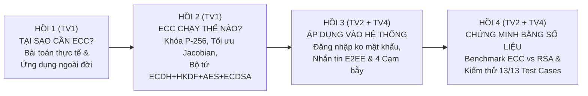

# KHUNG BÁO CÁO DỄ HIỂU & KẾ HOẠCH PHỐI HỢP NHÓM 4 NGƯỜI

Tài liệu này thiết kế lại khung báo cáo theo ngôn ngữ **dễ hiểu, trực quan, thực tế** và chia việc khớp hoàn hảo cho **4 thành viên**:
- **Thành viên 1 (Nội dung & Báo cáo 1)**: Phụ trách *Phần Nền tảng thực tế & Cơ chế hoạt động của thuật toán*.
- **Thành viên 2 (Nội dung & Báo cáo 2)**: Phụ trách *Phần Ứng dụng hệ thống ECC-SIS, Kịch bản tấn công & Đánh giá hiệu năng*.
- **Thành viên 3 (Slide & Thuyết trình)**: Chuyển hóa báo cáo của TV1 + TV2 thành *12 Slide trực quan & dẫn dắt câu chuyện*.
- **Thành viên 4 (Code chính & Live Demo)**: Vận hành mã nguồn `c:\poipoi`, cung cấp ảnh chụp/số liệu cho TV1, TV2, TV3 và phụ trách *Live Demo + Hỏi đáp kỹ thuật*.

---

## 1. "SỢI CHỈ ĐỎ" GIÚP BÁO CÁO VÀ SLIDE LIÊN KẾT MƯỢT MÀ

Để bài báo cáo không bị rời rạc kiểu "nửa đầu chép lý thuyết toán, nửa sau ghép đại một cái web", cả 4 người cần bám theo **1 câu chuyện xuyên suốt gồm 4 Hồi**:

---

## 2. KHUNG BÁO CÁO DỄ HIỂU (CHIA RÕ CHO 2 NGƯỜI VIẾT BÁO CÁO)

Toàn bộ văn bản nháp chi tiết đã có sẵn trong [BAO_CAO_CHI_TIET.md](file:///c:/poipoi/docs/BAO_CAO_CHI_TIET.md). Hai bạn viết báo cáo chỉ cần chia đôi đúng theo khung dưới đây là **không bao giờ trùng lặp** mà ghép lại khớp 100%:

---

### PHẦN CỦA THÀNH VIÊN 1: TỪ BÀI TOÁN THỰC TẾ ĐẾN CƠ CHẾ HOẠT ĐỘNG (Chương 1 & Chương 2)
> **Mục tiêu của TV1**: Giúp người đọc hiểu *tại sao thế giới dùng ECC* và *bên trong thuật toán ECC các bước phối hợp với nhau như thế nào* mà không cần dùng toán học quá phức tạp.

#### Chương 1: Bài toán thực tế và Ứng dụng của ECC trong công nghiệp (~4–5 trang)
- **1.1. Ba điểm yếu của hệ thống thông tin truyền thống**:
  - Lưu dữ liệu rõ trên Server $\rightarrow$ Hacker hoặc Admin xấu lấy DB là lộ hết.
  - Dùng mật khẩu truyền thống $\rightarrow$ Dễ lộ do phishing, dò mật khẩu.
  - Dùng khóa RSA truyền thống $\rightarrow$ Khóa quá dài (3072 bit = 384 byte), sinh khóa quá chậm (mất 23 giây trên Python thuần).
- **1.2. ECC đang chạy ở đâu quanh ta? (Ví dụ thực tế)**:
  - **Passkeys / FaceID WebAuthn**: Đăng nhập không mật khẩu bằng chữ ký số ECDSA.
  - **Signal / WhatsApp / Zalo E2EE**: Mã hóa tin nhắn đầu cuối bằng ECDH.
  - **HTTPS (TLS 1.3)**: Tạo khóa phiên tạm thời mỗi lần truy cập web.
  - **Ví Blockchain (Bitcoin/Ethereum)**: Ký giao dịch chống giả mạo bằng đường cong `secp256k1`.
- **1.3. Giới thiệu đề tài ECC-SIS**: Gom cả 4 ứng dụng thực tế trên vào một hệ thống trao đổi tin nhắn & tài liệu mật nội bộ.

#### Chương 2: Cơ chế hoạt động thực tế của ECC — Giải thích dễ hiểu (~6–8 trang)
*(TV1 lấy thông tin từ `ecc_core/` và Tab 2 "ECC Algorithm Lab" trên giao diện Web)*
- **2.1. Cặp khóa ECC thực chất là gì?**:
  - **Khóa bí mật ($d$)**: Là một số nguyên ngẫu nhiên 256-bit (giữ kín ở máy người dùng).
  - **Khóa công khai ($Q = d \cdot G$)**: Là tọa độ một điểm $(x, y)$ trên đường cong sau khi nhảy $d$ bước từ điểm gốc $G$. Tính xuôi mất `3.5 ms`, nhưng dò ngược từ $Q$ về $d$ là bất khả thi.
  - Giải thích **Nén điểm (Point Compression)**: Thay vì gửi cả $(x, y)$ tốn 65 byte, chỉ cần gửi $x$ và 1 byte báo chẵn/lẻ (tổng 33 byte, tiết kiệm 50% băng thông).
- **2.2. Bí quyết tăng tốc gấp ~5–6 lần nhờ Tọa độ Jacobian**:
  - Giải thích nôm na: Tính trên mặt phẳng $(x, y)$ (Affine) thì mỗi bước nhảy đều phải làm một phép chia modulo rất chậm (`mod_inv`). Đổi sang hệ tọa độ 3 chiều $(X, Y, Z)$ (Jacobian) giúp "nợ" toàn bộ phép chia lại, tính xong 256 bước mới chia đúng 1 lần duy nhất ở cuối.
- **2.3. Tại sao ECC không đi một mình mà luôn đi theo "Bộ tứ hoàn hảo"?**:
  - Giải thích rõ: ECC không dùng để mã hóa trực tiếp file dài vài MB. Trong thực tế, một gói tin bảo mật là sự phối hợp của 4 mảnh ghép:
    1. **Ephemeral ECDH**: Hai bên tự tính ra cùng một bí mật chung mà không cần gửi khóa qua mạng.
    2. **HKDF-SHA256**: Rèn bí mật chung đó thành chìa khóa AES chuẩn 256-bit.
    3. **AES-256-GCM**: Khóa hộp dữ liệu/file siêu tốc, kèm tem niêm phong 16 byte (Auth Tag) chống sửa nội dung.
    4. **ECDSA (RFC 6979)**: Con dấu chữ ký của người gửi đóng bên ngoài hộp, chứng minh chính chủ và chống giả mạo.

---

### PHẦN CỦA THÀNH VIÊN 2: HỆ THỐNG ỨNG DỤNG, CẠM BẪY BẢO MẬT & THỰC NGHIỆM (Chương 3, 4, 5, 6)
> **Mục tiêu của TV2**: Chỉ rõ *hệ thống ECC-SIS của nhóm vận hành thực tế thế nào*, *chống lại hacker ra sao*, và *con số đo đạc chứng minh điều gì*. (Nối tiếp ngay sau phần "Bộ tứ hoàn hảo" của TV1!).

#### Chương 3: Thiết kế và Vận hành Hệ thống ECC-SIS (~7–8 trang)
*(TV2 lấy thông tin từ `sis_app/` và Tab 1 + Tab 4 trên giao diện Web)*
- **3.1. Kiến trúc Zero-Knowledge Server (Máy chủ mù)**:
  - Trình duyệt người dùng tự sinh khóa và tự mã hóa bằng WebCrypto P-256; Máy chủ FastAPI + SQLite chỉ làm người đưa thư giữ các hộp đã khóa (`ciphertext_hex`).
- **3.2. Minh họa 3 luồng chạy thực tế (Kèm sơ đồ & ảnh chụp màn hình từ TV4)**:
  - **Luồng 1 — Đăng nhập không mật khẩu (ECDSA Challenge-Response)**: Server đưa câu đố ngẫu nhiên (`nonce`) $\rightarrow$ Máy Alice ký trả lời $\rightarrow$ Server kiểm tra đúng chữ ký thì cho vào.
  - **Luồng 2 — Alice gửi tin nhắn/file mật cho Bob**: Đưa gói JSON thực tế vào báo cáo để hội đồng thấy rõ trên mạng chỉ có chuỗi hex mã hóa (`ephemeral_pubkey_hex`, `nonce_hex`, `ciphertext_hex`, `signature_hex`).
  - **Luồng 3 — Nhật ký kiểm toán chuỗi băm (Hash-Chained Audit Log)**: Giống nguyên lý chuỗi khối mini — mỗi dòng nhật ký băm kèm mã băm của dòng trước đó, sửa 1 dòng trong DB là phát hiện ngay.

#### Chương 4: 4 Cạm bẫy thực tế khi lập trình ECC và Cách hệ thống phòng chống (~4–5 trang)
- **Cạm bẫy 1 — Lặp lại số ngẫu nhiên $k$ khi ký ECDSA (Vụ hack Sony PS3)**: Giải thích và đưa ảnh chụp màn hình tính năng *Nonce-Reuse Attack Demo* trên Tab 2 (lộ sạch khóa bí mật `d`), từ đó giải thích tại sao hệ thống dùng **RFC 6979**.
- **Cạm bẫy 2 — Gửi tọa độ điểm giả mạo (Invalid-Curve Attack)**: Cách hàm `validate_public_key` chặn ngay từ cửa (HTTP `400`).
- **Cạm bẫy 3 — Sửa lén bản mã hoặc đánh tráo tên file (MITM Tampering)**: Minh họa bằng nút *Simulate MITM Tamper* trên Tab 1 $\rightarrow$ Cả chữ ký ECDSA và AES-GCM đều báo đỏ từ chối.
- **Cạm bẫy 4 — Dùng lại gói tin đăng nhập cũ (Replay Attack)**: Chặn bằng cờ `used = 1` và thời hạn 120 giây.

#### Chương 5 & Chương 6: Đánh giá Hiệu năng thực tế (ECC vs RSA) & Kết luận (~5–6 trang)
*(TV2 lấy bảng số liệu từ Tab 3 "ECC vs RSA Benchmarks" và `python -m benchmarks.runner`)*
- Bảng so sánh **Jacobian (`13.37 ms`) vs Affine (`62.14 ms`)** $\rightarrow$ Nhanh hơn **4.65x**.
- Bảng so sánh **ECC P-256 vs RSA-3072** (cùng mức an toàn 128-bit):
  - Kích thước khóa công khai nén: **33 byte vs 384 byte** (nhỏ hơn **11.6 lần**).
  - Tốc độ sinh khóa: **3.47 ms vs 23,024 ms** (nhanh hơn **~6,629 lần** $\rightarrow$ giải thích vì sao chỉ ECC mới tạo khóa mới cho từng tin nhắn để làm Forward Secrecy được).
  - Tốc độ ký số: **5.05 ms vs 280.88 ms** (nhanh hơn **55.6 lần**).
  - Nhận xét công tâm: RSA xác thực chữ ký nhanh hơn (`1.51 ms` vs `8.23 ms`) nhờ mũ công khai nhỏ $e=65537$.
- Tổng kết 13/13 bài test tự động (`OK`) và hướng phát triển thực tế.

---

## 3. KHUNG 12 SLIDE CHO THÀNH VIÊN 3 (NGƯỜI LÀM SLIDE)

**Nguyên tắc vàng cho TV3**: Mỗi slide tối đa 4–5 gạch đầu dòng ngắn; ưu tiên hình vẽ, bảng so sánh và sơ đồ; dùng đúng thuật ngữ mà TV1 và TV2 đã viết trong báo cáo.

| Slide | Tiêu đề Slide | Nội dung cốt lõi trên Slide | Nguồn lấy từ ai? |
|---:|---|---|---|
| **1** | **Trang bìa** | Tên đề tài + Tên 4 thành viên & vai trò | Cả nhóm |
| **2** | **Vấn đề thực tế** | 3 nỗi đau: Lộ DB máy chủ, Lộ mật khẩu, Khóa RSA 3072-bit quá nặng & chậm | TV1 (Mục 1.1) |
| **3** | **ECC trong thế giới thực** | 4 biểu tượng: Passkeys (Auth), Signal/Zalo (E2EE), TLS 1.3 (Web), Blockchain $\rightarrow$ Dẫn vào hệ thống **ECC-SIS** | TV1 (Mục 1.2) |
| **4** | **Bản chất khóa ECC & Tối ưu Jacobian** | Hình minh họa $Q = d \cdot G$ + So sánh Affine vs Jacobian (1 phép chia duy nhất $\rightarrow$ nhanh gấp ~5–6x) | TV1 (Mục 2.1, 2.2) |
| **5** | **"Bộ tứ" trong một gói tin E2EE** | Sơ đồ 4 khối: `Ephemeral ECDH` $\rightarrow$ `HKDF-SHA256` $\rightarrow$ `AES-256-GCM` + `ECDSA Signature` | TV1 (Mục 2.3) |
| **6** | **Kiến trúc hệ thống ECC-SIS** | Sơ đồ khối: Trình duyệt (WebCrypto P-256 giữ khóa bí mật) $\leftrightarrow$ FastAPI $\leftrightarrow$ SQLite Zero-Knowledge DB | TV2 (Mục 3.1) |
| **7** | **Luồng vận hành thực tế** | 2 sơ đồ ngắn: (1) Đăng nhập ECDSA Challenge-Response & (2) Gửi tin nhắn/file E2EE giữa Alice và Bob | TV2 (Mục 3.2) |
| **8** | **4 Cạm bẫy bảo mật & Cách chặn** | Bảng 4 dòng: Trùng Nonce $k$ (RFC 6979), Điểm giả (Validate Point), Sửa bản mã (GCM+ECDSA), Replay Attack | TV2 (Chương 4) |
| **9** | **DEMO TRỰC TIẾP HỆ THỐNG** | Slide chuyển cảnh liệt kê 4 bước Demo trực tiếp trên trình duyệt (Nhường sân khấu cho TV4) | TV4 (Code chính) |
| **10** | **Kết quả Benchmark: ECC vs RSA** | Biểu đồ cột: Kích thước khóa (`33B` vs `384B`) & Thời gian sinh khóa (`3.47ms` vs `23,024ms`) ở mức 128-bit | TV2 + TV4 (Chương 5) |
| **11** | **Phân tích Đánh đổi (Trade-off)** | Khi nào ECC thắng tuyệt đối (Keygen, Sign, Bandwidth, Forward Secrecy) vs Điểm mạnh Verify của RSA | TV2 (Mục 5.4) |
| **12** | **Kết luận & Hướng phát triển** | Tóm tắt kết quả (13/13 tests pass, hệ thống E2EE hoàn chỉnh) + Hướng mở rộng (Double Ratchet, Hybrid PQC) | TV2 (Chương 6) |

---

## 4. NHIỆM VỤ CỦA THÀNH VIÊN 4 (NGƯỜI LÀM CODE CHÍNH)

Mã nguồn toàn bộ dự án đã hoàn thiện 100% tại `c:\poipoi`. Để cả nhóm làm việc trơn tru, TV4 thực hiện 3 việc sau:

1. **Chạy hệ thống và xuất "Gói dữ liệu bàn giao" cho TV1, TV2, TV3 (chỉ mất 10 phút)**:
   - Chạy `uvicorn sis_app.main:app --host 127.0.0.1 --port 8000`, mở `http://127.0.0.1:8000`.
   - Chụp **5 ảnh màn hình** rõ nét gửi vào nhóm chat:
     1. *Ảnh 1 (cho TV1 & TV3)*: Tab **ECC Algorithm Lab** — Đồ thị đường cong `toy_p97` và bảng chạy từng bước Double-and-Add.
     2. *Ảnh 2 (cho TV2 & TV3)*: Tab **ECC Algorithm Lab** — Khung kết quả *Nonce-Reuse Private Key Recovery* (hiển thị khóa bí mật bị khôi phục thành công khi trùng nonce).
     3. *Ảnh 3 (cho TV2 & TV3)*: Tab **E2EE Messaging & Files** — Alice gửi tin nhắn/file cho Bob, kèm khung **Server DB Inspector** chứng minh DB chỉ có bản mã hex.
     4. *Ảnh 4 (cho TV2 & TV3)*: Tab **E2EE Messaging & Files** — Cảnh báo đỏ `ECDSA Sig: INVALID` sau khi bấm nút **Simulate MITM Tamper**.
     5. *Ảnh 5 (cho TV2 & TV3)*: Tab **ECC vs RSA Benchmarks** & Tab **Audit Log** sau khi bấm chạy.
2. **Họp nhóm 15 phút giải thích luồng chạy thực tế trên giao diện Web**:
   - Không cần bắt TV1, TV2, TV3 đọc từng dòng code Python; chỉ cần mở Web UI bấm qua 4 tab để các bạn thấy mắt tận tay cách khóa sinh ra, bản mã lưu thế nào và khi sửa 1 byte thì hệ thống chặn ra sao.
3. **Đảm nhận phần Live Demo (3–4 phút) và trả lời câu hỏi kỹ thuật khi bảo vệ**.

---

## 5. QUY TRÌNH RÁP NỐI 3 BƯỚC ĐỂ BÀI BÁO CÁO XUẤT SẮC

- **Bước 1 (Khởi động — Ngày 1)**: TV4 chạy Web App, chụp 5 ảnh màn hình gửi cho nhóm. Cả nhóm đọc qua [BAO_CAO_CHI_TIET.md](file:///c:/poipoi/docs/BAO_CAO_CHI_TIET.md) để thống nhất tên gọi các thuật ngữ (ví dụ: thống nhất gọi là *Khóa tạm thời Ephemeral ECDH*, *Máy chủ Zero-Knowledge*, *Đăng nhập không mật khẩu ECDSA Challenge-Response*).
- **Bước 2 (Triển khai song song — Ngày 2–3)**:
  - **TV1** biên tập hoàn chỉnh Chương 1 & Chương 2 từ khung có sẵn, chèn Ảnh 1.
  - **TV2** biên tập hoàn chỉnh Chương 3, 4, 5, 6 từ khung có sẵn, chèn Ảnh 2, 3, 4, 5.
  - **TV3** dựng 12 Slide theo đúng bảng ở Mục 3 và chèn các sơ đồ + 5 ảnh chụp từ TV4.
- **Bước 3 (Ráp tổng duyệt — Ngày 4)**: Ghép phần của TV1 và TV2 thành 1 file Word/PDF duy nhất; chạy thử 1 lượt thuyết trình nối tiếp (TV1 giới thiệu Hồi 1–2 $\rightarrow$ TV2 giới thiệu Hồi 3 $\rightarrow$ TV4 bấm Live Demo $\rightarrow$ TV3/TV2 chốt Benchmark & Kết luận).
